# 00. 전체 ERD (관계 요약)

> 기준 : `src/main/resources/db/ddl/*.sql` (2026-11-06). 테이블 23개.
> 컬럼 정의는 영역별 설계 문서 ([01_auth_menu_code.md](01_auth_menu_code.md), [03_notice.md](03_notice.md))를 따른다.
> 감사 컬럼(CREATED_BY/AT, UPDATED_BY/AT)은 모든 테이블 공통이라 생략한다.

## 1. 영역

| 영역 | 테이블 | 비고 |
|---|---|---|
| 공통코드 | TB_CODE_GROUP, TB_CODE_GROUP_LANG, TB_CODE, TB_CODE_LANG | 다른 모든 영역의 `*_CD` 값의 기준 (FK 없이 코드 참조) |
| 인사 마스터 | TB_WORKPLACE, TB_DEPT, TB_USER, TB_USER_DEPT | 사업장 → 부서(계층) → 사용자(다중 소속) |
| 권한 | TB_ROLE, TB_ROLE_LANG, TB_USER_ROLE, TB_DEPT_ROLE | 사용자·부서에 기간부 부여 |
| 메뉴 | TB_MENU, TB_MENU_LANG, TB_ROLE_MENU | 권한 × 메뉴 = LIST/ADD/EDIT/DEL, 메뉴 PERM_CD = API 리소스 |
| 공지사항(게시판) | TB_NOTICE, TB_NOTICE_I18N, TB_NOTICE_FILE, TB_NOTICE_MAIL_TARGET, TB_NOTICE_MAIL_HIST, TB_NOTICE_VIEW_LOG | 권한 리소스 `board` |
| 메일 | TB_MAIL_TEMPLATE | 언어별 템플릿 |
| 샘플 | TB_SAMPLE | 독립 (구조 예시) |

## 2. ERD

실선 = DB FK, 점선 = 논리 참조(FK 없음, 코드·ID 로 참조).

```mermaid
erDiagram
  TB_CODE_GROUP ||--o{ TB_CODE_GROUP_LANG : "언어별 이름"
  TB_CODE_GROUP ||--o{ TB_CODE : "코드"
  TB_CODE ||--o{ TB_CODE_LANG : "언어별 이름"

  TB_WORKPLACE ||--o{ TB_DEPT : "소속 부서"
  TB_DEPT |o--o{ TB_DEPT : "상위 부서"
  TB_USER ||--o{ TB_USER_DEPT : "소속"
  TB_DEPT ||--o{ TB_USER_DEPT : "구성원"

  TB_ROLE ||--o{ TB_ROLE_LANG : "언어별 이름"
  TB_USER ||--o{ TB_USER_ROLE : "직접 부여"
  TB_ROLE ||--o{ TB_USER_ROLE : ""
  TB_DEPT ||--o{ TB_DEPT_ROLE : "부서 부여"
  TB_ROLE ||--o{ TB_DEPT_ROLE : ""

  TB_MENU |o--o{ TB_MENU : "상위 메뉴"
  TB_MENU ||--o{ TB_MENU_LANG : "언어별 이름·본문"
  TB_ROLE ||--o{ TB_ROLE_MENU : "메뉴 권한"
  TB_MENU ||--o{ TB_ROLE_MENU : ""

  TB_NOTICE ||--|{ TB_NOTICE_I18N : "언어별 제목·본문"
  TB_NOTICE ||--o{ TB_NOTICE_FILE : "첨부"
  TB_NOTICE ||--o{ TB_NOTICE_MAIL_TARGET : "메일 대상"
  TB_NOTICE ||..o{ TB_NOTICE_MAIL_HIST : "발송 이력 (논리)"
  TB_NOTICE ||..o{ TB_NOTICE_VIEW_LOG : "조회 기록 (논리)"
  TB_USER ||..o{ TB_NOTICE_MAIL_HIST : "수신자 RECEIVER_ID (논리)"
  TB_USER ||..o{ TB_NOTICE_VIEW_LOG : "조회자 (논리)"
  TB_WORKPLACE ||..o{ TB_NOTICE_MAIL_TARGET : "TARGET_TYPE=WORKPLACE (논리)"
  TB_DEPT ||..o{ TB_NOTICE_MAIL_TARGET : "TARGET_TYPE=DEPT (논리)"

  TB_CODE_GROUP {
    string GROUP_CD PK
    string SYSTEM_YN
    string USE_YN
  }
  TB_CODE {
    string GROUP_CD PK,FK
    string CODE PK
    string ATTR1 "LANG: 에디터 언어팩"
    string USE_YN
  }
  TB_CODE_GROUP_LANG {
    string GROUP_CD PK,FK
    string LANG_CD PK
    string GROUP_NM
  }
  TB_CODE_LANG {
    string GROUP_CD PK,FK
    string CODE PK,FK
    string LANG_CD PK
    string CODE_NM
  }
  TB_WORKPLACE {
    string WORKPLACE_CD PK
    string WORKPLACE_NM
    string WORKPLACE_NM_EN
  }
  TB_DEPT {
    string DEPT_CD PK
    string WORKPLACE_CD FK
    string PARENT_DEPT_CD FK
    string DEPT_NM
    string DEPT_NM_EN
  }
  TB_USER {
    string USER_ID PK
    string IDP_SUBJECT UK "Keycloak sub"
    string USER_TYPE_CD "USER_TYPE"
    string LANG_CD "LANG, NULL=기본"
    string USE_YN
  }
  TB_USER_DEPT {
    string USER_ID PK,FK
    string DEPT_CD PK,FK
    string MAIN_DEPT_YN
  }
  TB_ROLE {
    number ROLE_ID PK
    string ROLE_CD UK
    string ROLE_TYPE_CD "ROLE_TYPE"
    number ROLE_LEVEL "1=시스템관리자"
    string MODULE_CD "MODULE"
    string SYSTEM_YN
  }
  TB_ROLE_LANG {
    number ROLE_ID PK,FK
    string LANG_CD PK
    string ROLE_NM
  }
  TB_USER_ROLE {
    number USER_ROLE_ID PK
    string USER_ID FK
    number ROLE_ID FK
    date START_DT
    date END_DT
  }
  TB_DEPT_ROLE {
    number DEPT_ROLE_ID PK
    string DEPT_CD FK
    number ROLE_ID FK
    date START_DT
    date END_DT
  }
  TB_MENU {
    number MENU_ID PK
    number PARENT_MENU_ID FK
    string VIEW_TYPE_CD "MENU LINK CONTENT IFRAME"
    string MENU_URL
    string PERM_CD "API 리소스 (sample, board ...)"
    string MODULE_CD
  }
  TB_MENU_LANG {
    number MENU_ID PK,FK
    string LANG_CD PK
    string MENU_NM
    clob MENU_CONTENT
  }
  TB_ROLE_MENU {
    number ROLE_ID PK,FK
    number MENU_ID PK,FK
    string LIST_YN
    string ADD_YN
    string EDIT_YN
    string DEL_YN
  }
  TB_NOTICE {
    number NOTICE_ID PK
    string CATEGORY_CD "NOTICE_CATEGORY"
    string BASE_LANG_CD "대표 언어"
    timestamp POST_DATE
    string POPUP_YN
    string MAIL_SEND_TYPE_CD
    string MAIL_STATUS_CD
    string DEL_YN
  }
  TB_NOTICE_I18N {
    number NOTICE_ID PK,FK
    string LANG_CD PK
    string TITLE
    clob CONTENT_HTML
  }
  TB_NOTICE_FILE {
    number FILE_ID PK
    number NOTICE_ID FK
    string ORG_FILE_NM
    string SAVE_PATH
  }
  TB_NOTICE_MAIL_TARGET {
    number NOTICE_ID PK,FK
    string TARGET_TYPE PK "WORKPLACE DEPT"
    string TARGET_CD PK
    string INCLUDE_SUB_YN
  }
  TB_NOTICE_MAIL_HIST {
    number HIST_ID PK
    number NOTICE_ID
    string RECEIVER_ID
    string LANG_CD
    string STATUS_CD
  }
  TB_NOTICE_VIEW_LOG {
    number NOTICE_ID PK
    string USER_ID PK
    date VIEW_DATE PK
  }
  TB_MAIL_TEMPLATE {
    string TEMPLATE_CD PK
    string LANG_CD PK
    string SUBJECT
  }
  TB_SAMPLE {
    number SAMPLE_ID PK
    string NAME UK
  }
```



## 3. 관계 목록

### 3.1 DB FK

| 자식 | 컬럼 | 부모 | 카디널리티 | 의미 |
|---|---|---|---|---|
| TB_CODE_GROUP_LANG | GROUP_CD | TB_CODE_GROUP | N : 1 | 그룹 언어별 이름 |
| TB_CODE | GROUP_CD | TB_CODE_GROUP | N : 1 | 그룹의 코드 |
| TB_CODE_LANG | GROUP_CD, CODE | TB_CODE | N : 1 | 코드 언어별 이름 |
| TB_DEPT | WORKPLACE_CD | TB_WORKPLACE | N : 0..1 | 부서의 사업장 |
| TB_DEPT | PARENT_DEPT_CD | TB_DEPT | N : 0..1 | 부서 계층 (자기 참조) |
| TB_USER_DEPT | USER_ID / DEPT_CD | TB_USER / TB_DEPT | N : M | 사용자 다중 소속 (주 부서 MAIN_DEPT_YN) |
| TB_ROLE_LANG | ROLE_ID | TB_ROLE | N : 1 | 권한 언어별 이름 |
| TB_USER_ROLE | USER_ID / ROLE_ID | TB_USER / TB_ROLE | N : M | 사용자 직접 부여 (기간) |
| TB_DEPT_ROLE | DEPT_CD / ROLE_ID | TB_DEPT / TB_ROLE | N : M | 부서 부여 (기간, 소속 사용자 전원) |
| TB_MENU | PARENT_MENU_ID | TB_MENU | N : 0..1 | 메뉴 계층 (자기 참조) |
| TB_MENU_LANG | MENU_ID | TB_MENU | N : 1 | 메뉴 언어별 이름·본문(CONTENT) |
| TB_ROLE_MENU | ROLE_ID / MENU_ID | TB_ROLE / TB_MENU | N : M | 권한별 메뉴 LIST/ADD/EDIT/DEL |
| TB_NOTICE_I18N | NOTICE_ID | TB_NOTICE | 1..N : 1 | 공지 언어 버전 (최소 1개) |
| TB_NOTICE_FILE | NOTICE_ID | TB_NOTICE | N : 1 | 첨부 (언어 공통) |
| TB_NOTICE_MAIL_TARGET | NOTICE_ID | TB_NOTICE | N : 1 | 메일 발송 대상 |

### 3.2 논리 참조 (FK 없음)

| 컬럼 | 참조 | FK 를 두지 않은 이유 |
|---|---|---|
| 모든 `LANG_CD` | TB_CODE (LANG) | 언어 추가·사용 중지를 공통코드만으로 (코드 수정 없이 확장) |
| `USER_TYPE_CD`, `ROLE_TYPE_CD`, `MODULE_CD`, `VIEW_TYPE_CD`, `CATEGORY_CD`, `TAG_CD`, `MAIL_*_CD`, `TARGET_TYPE`, `STATUS_CD` | TB_CODE (각 그룹) | 공통코드 그룹 참조 (복합키 FK 대신 앱 검증) |
| TB_NOTICE_MAIL_TARGET.TARGET_CD | TB_WORKPLACE 또는 TB_DEPT (TARGET_TYPE 에 따라) | 다형 참조. 명칭은 저장하지 않고 조회 시 인사 마스터에서 |
| TB_NOTICE_MAIL_HIST.NOTICE_ID / RECEIVER_ID | TB_NOTICE / TB_USER | 이력은 원본 삭제·퇴사와 무관하게 보존 |
| TB_NOTICE_VIEW_LOG.NOTICE_ID / USER_ID | TB_NOTICE / TB_USER | 로그성 데이터 (하루 1회 조회수 집계) |
| TB_MAIL_TEMPLATE.TEMPLATE_CD | 앱 상수 | 템플릿 종류는 코드에서 정의 |
| TB_MENU.PERM_CD | API 리소스 (SecurityConfig, Keycloak scope) | DB 밖 개념 (sample, board, code, menu, role) |
| TB_USER.IDP_SUBJECT | Keycloak 사용자 id (토큰 `sub`) | 외부 IdP |
| 감사 컬럼 CREATED_BY / UPDATED_BY | TB_USER.USER_ID | 공통 감사 (작성자 표시 등) |

## 4. 권한 계산 경로 (테이블 기준)

```
토큰 sub ─▶ TB_USER.IDP_SUBJECT ─▶ USER_ID
   ├─ TB_USER_ROLE (오늘 ∈ START_DT~END_DT) ───────────┐
   └─ TB_USER_DEPT ─▶ TB_DEPT_ROLE (오늘 ∈ 기간) ───────┤
                                                       ▼
                                  TB_ROLE (USE_YN='Y') = 유효 권한 → ROLE_{ROLE_CD}
                                                       │
                                  TB_ROLE_MENU (LIST/ADD/EDIT/DEL)
                                                       │
                                  TB_MENU.PERM_CD (USE_YN='Y')
                                                       ▼
                       {PERM_CD}.list|add|edit|del  ∩  토큰 scope  → SCOPE_*
```

- 내 메뉴(`/menus/me`)도 같은 경로: 유효 권한의 TB_ROLE_MENU 중 LIST_YN='Y' 메뉴 + 상위 메뉴, 이름은 TB_MENU_LANG (사용자 언어).
- 공지 메일 대상: TB_NOTICE_MAIL_TARGET → (WORKPLACE) TB_DEPT.WORKPLACE_CD / (DEPT) TB_DEPT 계층(INCLUDE_SUB_YN) → TB_USER_DEPT → TB_USER (발송 시점 기준, 수신자 LANG_CD 로 언어 선택).

## 5. 다국어 저장 패턴

| 대상 | 방식 |
|---|---|
| 공통코드 그룹·코드, 권한, 메뉴 | `*_LANG` 자식 테이블 (PK = 부모키 + LANG_CD) |
| 공지사항 | `TB_NOTICE_I18N` (언어별 제목·본문) + 대표 언어 `BASE_LANG_CD` |
| 메일 템플릿 | PK 에 LANG_CD 포함 |
| 인사 마스터 (사업장·부서) | 국문/영문 컬럼 (`*_NM`, `*_NM_EN`) — 인사 시스템 연동 형식 유지, ko = 국문, 그 외 = 영문 |
