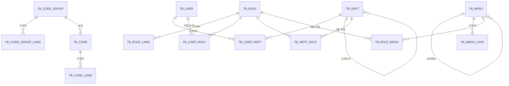

# 01. 권한 / 메뉴 / 공통코드 테이블 설계

| 항목 | 내용 |
|---|---|
| 상태 | 설계 확정 · 구현 완료 (Entity / Repository / local 초기 데이터) |
| 작성일 | 2026-11-05 |
| DDL (Oracle) | [`src/main/resources/db/ddl/01_auth_menu_code.sql`](../../src/main/resources/db/ddl/01_auth_menu_code.sql) |
| 초기 데이터 (local) | [`src/main/resources/db/data/01_auth_menu_code.sql`](../../src/main/resources/db/data/01_auth_menu_code.sql) |
| 테스트 결과 | [`docs/reports/TEST_REPORT.md`](../reports/TEST_REPORT.md) — 40건 전체 성공 |

- 공통 컬럼 `CREATED_BY, CREATED_AT, UPDATED_BY, UPDATED_AT` 은 아래 표에서 생략

---

## 1. ERD



| 영역 | 테이블 |
|---|---|
| 공통코드 | `TB_CODE_GROUP`, `TB_CODE_GROUP_LANG`, `TB_CODE`, `TB_CODE_LANG` |
| 사용자/부서 | `TB_USER`, `TB_DEPT`, `TB_USER_DEPT` |
| 권한 | `TB_ROLE`, `TB_ROLE_LANG`, `TB_USER_ROLE`, `TB_DEPT_ROLE` |
| 메뉴 | `TB_MENU`, `TB_MENU_LANG`, `TB_ROLE_MENU` |

---

## 2. 설계 원칙

| 항목 | 결정 | 이유 |
|---|---|---|
| 다국어 | 엔티티별 `_LANG` 테이블 (PK: 원본키 + `LANG_CD`) | 언어 추가 시 컬럼 변경 없음. 언어별 필수값(NOT NULL) 보장 |
| 다국어 Fallback | 요청 언어 없으면 `ko_KR` 로 조회 | 번역 누락 시 빈 화면 방지 |
| 공통코드 참조 | `*_CD` 컬럼, DB FK 없음 | 코드 그룹이 컬럼에 고정이라 FK 불가 → 애플리케이션에서 검증 |
| 실제 관계 | DB FK 제약조건 사용 | 무결성 보장 (JPA 는 FK 컬럼만 매핑, 연관관계 매핑 안 함) |
| PK | 업무 테이블은 시퀀스, 코드성/매핑 테이블은 자연키 | 공통코드·다국어는 코드 자체가 식별자 |
| 유효기간 | `START_DT` NOT NULL, `END_DT` 기본값 `9999-12-31` | `BETWEEN` 한 줄로 조회, NULL 처리 불필요, 인덱스 사용 가능 |
| 여부 컬럼 | `VARCHAR2(1)` `Y/N` | `CHAR` 공백 패딩 비교 이슈 회피 (개발 가이드 8장 함께 수정) |

---

## 3. 공통코드

### TB_CODE_GROUP (공통코드 그룹)
| 컬럼 | 타입 | Null | 설명 |
|---|---|---|---|
| **GROUP_CD** (PK) | VARCHAR2(50) | N | 그룹코드 (예: `MENU_VIEW_TYPE`) |
| GROUP_DESC | VARCHAR2(1000) | Y | 설명 (관리용) |
| SORT_ORDER | NUMBER(5) | N | 정렬순서 |
| SYSTEM_YN | VARCHAR2(1) | N | 시스템코드 (Y: 화면에서 삭제/코드변경 불가) |
| USE_YN | VARCHAR2(1) | N | 사용여부 |

### TB_CODE_GROUP_LANG (그룹 다국어)
| 컬럼 | 타입 | Null | 설명 |
|---|---|---|---|
| **GROUP_CD** (PK, FK) | VARCHAR2(50) | N | 그룹코드 |
| **LANG_CD** (PK) | VARCHAR2(10) | N | 언어 (`ko_KR`, `en_US`) |
| GROUP_NM | VARCHAR2(200) | N | 그룹명 |

### TB_CODE (공통코드)
| 컬럼 | 타입 | Null | 설명 |
|---|---|---|---|
| **GROUP_CD** (PK, FK) | VARCHAR2(50) | N | 그룹코드 |
| **CODE** (PK) | VARCHAR2(50) | N | 코드 |
| CODE_DESC | VARCHAR2(1000) | Y | 설명 (관리용) |
| SORT_ORDER | NUMBER(5) | N | 정렬순서 |
| ATTR1 ~ ATTR3 | VARCHAR2(200) | Y | 확장속성 (아이콘, 색상, 외부 매핑값 등) |
| USE_YN | VARCHAR2(1) | N | 사용여부 |

### TB_CODE_LANG (코드 다국어)
| 컬럼 | 타입 | Null | 설명 |
|---|---|---|---|
| **GROUP_CD, CODE** (PK, FK) | | N | 코드 |
| **LANG_CD** (PK) | VARCHAR2(10) | N | 언어 |
| CODE_NM | VARCHAR2(200) | N | 코드명 |

### 초기 코드 그룹
| GROUP_CD | 코드 | 비고 |
|---|---|---|
| `LANG` | ko_KR, en_US | 지원 언어 |
| `MODULE` | TX, WS | 모듈 (N개 확장) |
| `ROLE_TYPE` | SYSTEM_ADMIN, MODULE_MASTER, MODULE_MANAGER, GENERAL_USER | 권한 유형 |
| `USER_TYPE` | EMP(임직원), SAIT_GPA, AFFILIATE(관계사), PARTNER(협력사), NON_REAL(비실명계정) | 사용자 유형 |
| `MENU_VIEW_TYPE` | MENU, LINK, CONTENT(본문), IFRAME | 메뉴 조회유형 |

---

## 4. 사용자 / 부서

> 인사 시스템·Keycloak 에서 동기화되는 대상으로 가정하고, **권한 매핑에 필요한 최소 컬럼만** 정의했다.

### TB_USER (사용자)
| 컬럼 | 타입 | Null | 설명 |
|---|---|---|---|
| **USER_ID** (PK) | VARCHAR2(50) | N | 사용자ID (로그인ID = Keycloak username, 표시/감사용) |
| IDP_SUBJECT (UK) | VARCHAR2(64) | Y | IdP 사용자 고유ID (Keycloak user id = 토큰 `sub`). **권한 매핑 기준** — 사용자명은 변경·위조 가능하므로 권한 매핑에 쓰지 않는다 (`UK_USER_01`) |
| USER_NM | VARCHAR2(100) | N | 사용자명 |
| EMAIL | VARCHAR2(200) | Y | 이메일 |
| USER_TYPE_CD | VARCHAR2(50) | N | 사용자유형 (코드 `USER_TYPE`) |
| COMPANY_NM | VARCHAR2(200) | Y | 소속회사 (관계사/협력사) |
| USE_YN | VARCHAR2(1) | N | 사용여부 |

### TB_DEPT (부서)
| 컬럼 | 타입 | Null | 설명 |
|---|---|---|---|
| **DEPT_CD** (PK) | VARCHAR2(50) | N | 부서코드 |
| DEPT_NM | VARCHAR2(200) | N | 부서명 |
| PARENT_DEPT_CD (FK) | VARCHAR2(50) | Y | 상위부서 |
| SORT_ORDER, USE_YN | | N | |

### TB_USER_DEPT (사용자 소속부서, N개)
| 컬럼 | 타입 | Null | 설명 |
|---|---|---|---|
| **USER_ID** (PK, FK) | VARCHAR2(50) | N | 사용자 |
| **DEPT_CD** (PK, FK) | VARCHAR2(50) | N | 부서 |
| MAIN_DEPT_YN | VARCHAR2(1) | N | 주부서여부 |

---

## 5. 권한

### 권한 레벨 모델

```
Level 1  시스템관리자      SYS_ADMIN                     (모듈 무관, 전체 메뉴)
Level 2  모듈마스터        TX_MASTER, WS_MASTER, ...      (모듈별)
Level 3  모듈매니저        TX_MANAGER, WS_MANAGER, ...    (모듈별)
         └ 커스텀 예시     TX_MANAGER_READ                (Level 3 동급, 메뉴권한은 조회만)
Level 4  일반사용자        USER_EMP, USER_SAIT_GPA, USER_AFFILIATE, USER_PARTNER, USER_NON_REAL
```

- **레벨(`ROLE_LEVEL`)** 은 "등급"을, **메뉴권한(`TB_ROLE_MENU`)** 은 "실제로 할 수 있는 것"을 표현한다.
  → "모듈매니저와 동급인데 조회만 가능" = `ROLE_LEVEL=3` + 메뉴권한 `LIST_YN=Y` 만 부여
- 커스텀 권한은 `TB_ROLE` 에 행을 추가하면 된다. 기본 제공 권한은 `SYSTEM_YN='Y'` 로 삭제 방지.
- 모듈이 추가되면 `MODULE` 코드 추가 + 해당 모듈 Master/Manager 권한 행 추가.

### TB_ROLE (권한)
| 컬럼 | 타입 | Null | 설명 |
|---|---|---|---|
| **ROLE_ID** (PK) | NUMBER(19) | N | `SQ_ROLE` |
| ROLE_CD (UK) | VARCHAR2(50) | N | 권한코드 (`TX_MANAGER` 등, 프로그램/Keycloak 연계용) |
| ROLE_TYPE_CD | VARCHAR2(50) | N | 권한유형 (코드 `ROLE_TYPE`) |
| ROLE_LEVEL | NUMBER(2) | N | 1~4 (작을수록 상위) |
| MODULE_CD | VARCHAR2(50) | Y | 모듈 (코드 `MODULE`, 모듈 무관이면 NULL) |
| ROLE_DESC | VARCHAR2(1000) | Y | 설명 |
| SORT_ORDER | NUMBER(5) | N | 정렬순서 |
| SYSTEM_YN | VARCHAR2(1) | N | 기본권한 (삭제/코드변경 불가) |
| USE_YN | VARCHAR2(1) | N | 사용여부 |

### TB_ROLE_LANG (권한명 다국어)
| 컬럼 | 타입 | Null | 설명 |
|---|---|---|---|
| **ROLE_ID** (PK, FK), **LANG_CD** (PK) | | N | |
| ROLE_NM | VARCHAR2(200) | N | 권한명 |

### TB_USER_ROLE (사용자 권한 부여) / TB_DEPT_ROLE (부서 권한 부여)
| 컬럼 | 타입 | Null | 설명 |
|---|---|---|---|
| **USER_ROLE_ID / DEPT_ROLE_ID** (PK) | NUMBER(19) | N | 시퀀스 |
| USER_ID / DEPT_CD (FK) | VARCHAR2(50) | N | 대상 사용자 / 부서 |
| ROLE_ID (FK) | NUMBER(19) | N | 권한 |
| START_DT | DATE | N | 권한시작일 |
| END_DT | DATE | N | 권한종료일 (기본 `9999-12-31` = 무기한) |
| GRANT_REASON | VARCHAR2(1000) | Y | 부여사유 |

- PK 를 (사용자, 권한) 이 아닌 **대리키**로 둔 이유: 같은 권한을 기간을 달리해 재부여한 **이력**을 남기기 위함.
- 부서 부여 권한은 해당 부서 소속 사용자 전원에게 적용된다. (사용자가 여러 부서에 속하면 모든 부서 권한 합산)

### 사용자의 유효 권한 조회

```sql
SELECT R.*
  FROM TB_ROLE R
 WHERE R.USE_YN = 'Y'
   AND R.ROLE_ID IN (
         SELECT UR.ROLE_ID FROM TB_USER_ROLE UR
          WHERE UR.USER_ID = :userId
            AND :today BETWEEN UR.START_DT AND UR.END_DT
         UNION
         SELECT DR.ROLE_ID FROM TB_USER_DEPT UD
           JOIN TB_DEPT_ROLE DR ON DR.DEPT_CD = UD.DEPT_CD
          WHERE UD.USER_ID = :userId
            AND :today BETWEEN DR.START_DT AND DR.END_DT)
 ORDER BY R.ROLE_LEVEL
```

- 사용자의 **최상위 레벨** = 유효 권한 중 `MIN(ROLE_LEVEL)`
- 메뉴권한 = 유효 권한들의 `TB_ROLE_MENU` 를 **OR 합산** (하나라도 Y 면 Y)
- 시스템관리자(Level 1)는 메뉴권한 조회 없이 전체 허용

---

## 6. 메뉴

### TB_MENU (메뉴)
| 컬럼 | 타입 | Null | 설명 |
|---|---|---|---|
| **MENU_ID** (PK) | NUMBER(19) | N | `SQ_MENU` |
| PARENT_MENU_ID (FK) | NUMBER(19) | Y | 상위메뉴 (최상위 NULL), **깊이 제한 없음** |
| MODULE_CD | VARCHAR2(50) | Y | 모듈 (공통 메뉴는 NULL) |
| VIEW_TYPE_CD | VARCHAR2(50) | N | 조회유형 (코드 `MENU_VIEW_TYPE`) |
| MENU_URL | VARCHAR2(1000) | Y | MENU: 화면경로 / LINK·IFRAME: 대상 URL / CONTENT: NULL |
| PERM_CD | VARCHAR2(100) | Y | API 권한 리소스코드 (예: `sample`). 이 메뉴의 `TB_ROLE_MENU` 플래그가 `{PERM_CD}.{list\|add\|edit\|del}` API 권한이 된다 |
| NEW_WINDOW_YN | VARCHAR2(1) | N | 새창여부 (LINK) |
| SORT_ORDER | NUMBER(5) | N | 정렬순서 (같은 상위메뉴 내) |
| ADMIN_MENU_YN | VARCHAR2(1) | N | 관리자메뉴 (상위메뉴 하위에 붙는 관리자 전용 메뉴) |
| SIDE_MENU_YN | VARCHAR2(1) | N | 사이드메뉴 (상단 유틸리티 영역 출력) |
| DISPLAY_YN | VARCHAR2(1) | N | 노출여부 (N: 트리에 안 보이고 권한 체크용으로만 사용 - 상세/등록 화면 등) |
| USE_YN | VARCHAR2(1) | N | 사용여부 |

### TB_MENU_LANG (메뉴 다국어)
| 컬럼 | 타입 | Null | 설명 |
|---|---|---|---|
| **MENU_ID** (PK, FK), **LANG_CD** (PK) | | N | |
| MENU_NM | VARCHAR2(200) | N | 메뉴명 |
| MENU_CONTENT | CLOB | Y | 본문 HTML (조회유형 CONTENT) — 본문도 언어별로 관리 |

### TB_ROLE_MENU (권한별 메뉴 접근)
| 컬럼 | 타입 | Null | 설명 |
|---|---|---|---|
| **ROLE_ID** (PK, FK) | NUMBER(19) | N | 권한 |
| **MENU_ID** (PK, FK) | NUMBER(19) | N | 메뉴 |
| LIST_YN / ADD_YN / EDIT_YN / DEL_YN | VARCHAR2(1) | N | 조회/등록/수정/삭제 — Keycloak scope(`*.list/add/edit/del`)와 동일 체계 |

### API 권한 계산 (DB 업무 권한)

```
사용자(IDP_SUBJECT = sub, USE_YN='Y')
  → 유효 권한 (직접 부여 ∪ 소속부서 부여, 오늘 기준 기간 내)
  → TB_ROLE_MENU (권한별 메뉴 플래그) × TB_MENU.PERM_CD (USE_YN='Y', PERM_CD 있는 메뉴)
  → 권한들 OR 합산 → {PERM_CD}.list / .add / .edit / .del
```

- 최종 API 권한(`SCOPE_*`) = **IdP 가 허용한 scope ∩ 위 DB 권한** (`AuthorityResolver`). 둘 중 하나라도 없으면 거부.
- 예) tx.viewer: Keycloak 이 `sample.list/add` 를 허용해도 DB 권한이 `TX_MANAGER_READ`(조회만) + `USER_EMP`(조회) 이면 `sample.list` 만.
- 계산 결과는 `UserAuthorityService.loadBySubject` 에서 캐시 (`app.security.authority-cache-ttl`, 기본 60초) → 권한 변경은 최대 60초 뒤 반영.
- local 초기 데이터: 메뉴 3(거래목록)의 `PERM_CD='sample'` — TX_MASTER YYYY, TX_MANAGER YYYN, TX_MANAGER_READ·USER_EMP YNNN.

### 메뉴 트리 조회 (Oracle)

```sql
WITH T (MENU_ID, LVL, SORT_PATH) AS (
  SELECT MENU_ID, 1, LPAD(SORT_ORDER, 5, '0')
    FROM TB_MENU WHERE PARENT_MENU_ID IS NULL AND USE_YN = 'Y'
  UNION ALL
  SELECT M.MENU_ID, T.LVL + 1, T.SORT_PATH || '/' || LPAD(M.SORT_ORDER, 5, '0')
    FROM TB_MENU M JOIN T ON M.PARENT_MENU_ID = T.MENU_ID
   WHERE M.USE_YN = 'Y'
)
SELECT T.LVL, M.*, NVL(L.MENU_NM, K.MENU_NM) AS MENU_NM
  FROM T JOIN TB_MENU M ON M.MENU_ID = T.MENU_ID
  LEFT JOIN TB_MENU_LANG L ON L.MENU_ID = M.MENU_ID AND L.LANG_CD = :lang
  LEFT JOIN TB_MENU_LANG K ON K.MENU_ID = M.MENU_ID AND K.LANG_CD = 'ko_KR'
 ORDER BY T.SORT_PATH
```

> 메뉴는 변경이 적고 조회가 잦으므로, 애플리케이션에서는 **전체 메뉴를 한 번 읽어 메모리에서 트리 구성 + 캐시**하는 방식을 권장한다.
> (위 SQL 은 관리/검증용)

### 내 메뉴 API — `GET /api/v1/menus/me` (`MenuController` / `MenuService`)

| 항목 | 내용 |
|---|---|
| 인가 | 로그인 사용자 (scope 불필요) |
| 대상 | 유효 권한의 `TB_ROLE_MENU.LIST_YN='Y'` 메뉴 (`USE_YN='Y'`, `DISPLAY_YN='Y'`). 시스템관리자는 전체 메뉴·전체 권한 |
| 트리 | 상위 메뉴 권한이 없으면 하위 메뉴도 노출하지 않음. `SORT_ORDER` 순 |
| 다국어 | `Accept-Language` 의 `TB_MENU_LANG`, 없으면 ko_KR |
| 응답 노드 | `menuId, menuNm, moduleCd, viewTypeCd, menuUrl, newWindow, adminMenu, sideMenu, permission{list,add,edit,del}, children` |
| 서비스 계정 / 미등록 사용자 | 빈 목록 |

---

## 7. 가정 및 확인 필요 사항

설계 중 아래와 같이 **가정**했다. 다르면 알려주세요.

1. **"부서에 권한 맵핑"** → 부서 단위로 권한을 부여하면 그 부서 소속 사용자 전원에게 적용되는 것으로 해석했다. (`TB_DEPT_ROLE`)
2. **권한 시작/종료일**은 권한 자체가 아니라 **부여(매핑)** 에 있는 것으로 봤다. 권한 자체의 사용 중지는 `USE_YN`.
3. **일반사용자 5종**은 권한(Level 4)으로 만들고, 별도로 사용자 속성 `USER_TYPE_CD` 도 두었다.
   → 사용자 유형에 따라 일반사용자 권한을 **자동 부여**할지, 관리자가 **수동 부여**할지 결정 필요.
4. **메뉴의 모듈 소속**: 메뉴에 `MODULE_CD` 를 두어 모듈 마스터/매니저가 자기 모듈 메뉴만 관리하도록 했다.
5. **관리자메뉴**: `ADMIN_MENU_YN='Y'` 인 메뉴는 일반 메뉴 트리에서 숨기고, 해당 메뉴권한이 있는 사용자(주로 모듈 마스터/매니저)에게만 노출한다.
6. **사용자/부서 테이블**은 인사·Keycloak 연동 전 최소 정의다. 원천 시스템(인사 I/F 등) 확정 시 컬럼 보강.

---

## 8. 구현

### 8.1 테이블 - Entity - Repository 매핑

| 테이블 | Entity | PK 매핑 | Repository |
|---|---|---|---|
| TB_CODE_GROUP | `code.domain.model.CodeGroup` | `@Id groupCd` | `CodeGroupRepository` |
| TB_CODE_GROUP_LANG | `CodeGroupLang` | `@EmbeddedId CodeGroupLangId` | `CodeGroupLangRepository` |
| TB_CODE | `Code` | `@EmbeddedId CodeId` | `CodeRepository` |
| TB_CODE_LANG | `CodeLang` | `@EmbeddedId CodeLangId` | `CodeLangRepository` |
| TB_USER | `user.domain.model.User` | `@Id userId` | `UserRepository` |
| TB_DEPT | `Dept` | `@Id deptCd` | `DeptRepository` |
| TB_USER_DEPT | `UserDept` | `@EmbeddedId UserDeptId` | `UserDeptRepository` |
| TB_ROLE | `role.domain.model.Role` | 시퀀스 `SQ_ROLE` | `RoleRepository` |
| TB_ROLE_LANG | `RoleLang` | `@EmbeddedId RoleLangId` | `RoleLangRepository` |
| TB_USER_ROLE | `UserRole` (extends `BaseRoleGrant`) | 시퀀스 `SQ_USER_ROLE` | `UserRoleRepository` |
| TB_DEPT_ROLE | `DeptRole` (extends `BaseRoleGrant`) | 시퀀스 `SQ_DEPT_ROLE` | `DeptRoleRepository` |
| TB_ROLE_MENU | `RoleMenu` | `@EmbeddedId RoleMenuId` | `RoleMenuRepository` |
| TB_MENU | `menu.domain.model.Menu` | 시퀀스 `SQ_MENU` | `MenuRepository` |
| TB_MENU_LANG | `MenuLang` | `@EmbeddedId MenuLangId` | `MenuLangRepository` |

- 자연키/복합키 Entity 는 `AssignedIdEntity` 를 상속 → 신규 저장 시 SELECT 없이 바로 INSERT (`createdAt` 유무로 신규 판단)
- `BaseRoleGrant` : 사용자/부서 권한 부여 공통 (권한ID, 유효기간). 종료일 미지정 시 `9999-12-31`, 시작일 &gt; 종료일이면 생성 불가, `isValidOn(기준일)` 제공
- 연관관계(@ManyToOne 등)는 매핑하지 않고 FK 컬럼만 매핑 (개발 가이드 4.4)

### 8.2 주요 조회

| 기능 | 메서드 | 비고 |
|---|---|---|
| 사용자 유효 권한 | `RoleRepository.findEffectiveRoles(userId, baseDate)` | 직접 부여 ∪ 소속부서 부여, 기준일 유효분만, 레벨 순 |
| 권한들의 메뉴권한 | `RoleMenuRepository.findByIdRoleIdIn(roleIds)` | 메뉴별 OR 합산은 서비스에서 |
| 전체 메뉴 (트리용) | `MenuRepository.findByUseYnOrderBySortOrderAscIdAsc("Y")` | 메모리에서 트리 구성 |
| 메뉴명 (언어별) | `MenuLangRepository.findByIdLangCd(lang)` | 미존재 시 ko_KR fallback (서비스) |
| 그룹별 코드 | `CodeRepository.findByIdGroupCdAndUseYnOrderBySortOrderAsc(group, "Y")` | |
| 코드 유효성 검증 | `CodeRepository.existsByIdGroupCdAndIdCodeAndUseYn(...)` | `*_CD` 컬럼 저장 전 검증 (DB FK 없음) |

### 8.3 스키마 관리

- 스키마 기준은 **DDL 스크립트** (Oracle 문법). local(H2 Oracle 모드)은 기동 시 DDL 로 스키마 생성 → 초기 데이터 적재.
- local `ddl-auto: none` — H2 가 `NUMBER` 를 `NUMERIC` 으로 보고해 Hibernate validate 가 오탐하므로 사용하지 않고,
  Entity-DDL 일치는 통합 테스트(`AuthMenuCodeRepositoryTest`)로 검증한다. dev/prod(Oracle)는 `validate`.
- 실제 Oracle 검증: `OracleSchemaTest` (`./mvnw test -Poracle-it`, Oracle Free 23ai 컨테이너) — DDL·초기 데이터 실행 + `validate` + 권한/메뉴 쿼리.
  이 테스트로 시퀀스 재시작 문법 차이를 발견해 `ALTER SEQUENCE ... RESTART START WITH 101` (Oracle 18c+ / H2 공통)로 수정했다.

### 8.4 local 초기 데이터

| 구분 | 데이터 |
|---|---|
| 공통코드 | 그룹 5개 (LANG, MODULE, ROLE_TYPE, USER_TYPE, MENU_VIEW_TYPE), 코드 17개, ko_KR/en_US |
| 부서 | HQ(본사) > TX_TEAM, WS_TEAM, TF_TEAM(혁신TF) |
| 사용자 | admin, tx.master, tx.manager, tx.viewer(WS_TEAM 주부서 + TF_TEAM 겸직), emp01, partner01(협력사) — `IDP_SUBJECT` 는 Keycloak realm import 의 고정 user id (`00000000-0000-4000-8000-00000000000N`) |
| 권한 | 11개 — SYS_ADMIN / TX·WS_MASTER / TX·WS_MANAGER / **TX_MANAGER_READ(커스텀: 레벨3, 조회만)** / 일반사용자 5종 |
| 사용자 권한 부여 | admin=SYS_ADMIN, tx.master=TX_MASTER, tx.manager=TX_MANAGER, emp01=TX_MANAGER(**2025년 만료**)·WS_MANAGER(**2099년 시작 예정**), partner01=USER_PARTNER(2026년 계약기간) |
| 부서 권한 부여 | 4개 부서 전체 = USER_EMP, TF_TEAM = TX_MANAGER_READ(2026년까지) |
| 메뉴 | 16개, 최대 4뎁스 — 아래 트리 |
| 권한별 메뉴 | 47건 (시스템관리자는 매핑 없이 전체 허용) |

```
TX ─┬─ 거래관리 ─┬─ 거래목록 ── 거래상세 (DISPLAY_YN=N)
    │           └─ 거래관리 설정 (ADMIN_MENU_YN=Y)
    └─ TX 이용안내 (CONTENT, 언어별 본문)
WS ─┬─ 업무현황 ── 현황목록
    └─ WS 대시보드 (IFRAME)
시스템관리 ─┬─ 공통코드관리
           ├─ 메뉴관리
           └─ 권한관리
공지사항 (SIDE_MENU_YN=Y)
관련사이트 (LINK, 새창, SIDE_MENU_YN=Y)
```

기준일 2026-11-05 의 사용자별 유효 권한 (테스트로 검증):

| 사용자 | 유효 권한 | 비고 |
|---|---|---|
| admin | SYS_ADMIN, USER_EMP | |
| tx.viewer | TX_MANAGER_READ, USER_EMP | 직접 부여 없음 — **모두 부서 부여** (TF_TEAM, WS_TEAM) |
| emp01 | USER_EMP | 만료/시작 전 권한 제외 |
| partner01 | USER_PARTNER | 2027-01-01 기준으로는 권한 없음 |

> 시퀀스(SQ_ROLE, SQ_USER_ROLE, SQ_DEPT_ROLE, SQ_MENU)는 고정 ID 이후 **101** 부터 채번되도록 재설정.
