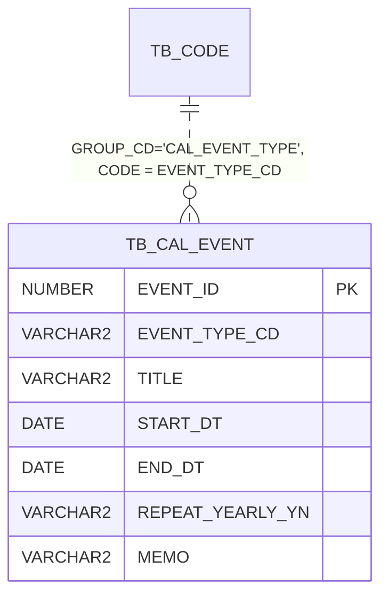

# 04. 생일 (캘린더)

| 항목 | 내용 |
|---|---|
| 상태 | 구현 완료 · 테스트 통과 (기본 166/166, Oracle 3/3, 화면 단위 37/37, 화면 E2E 57/57) |
| 작성일 | 2026-11-07 |
| DDL (Oracle) | [`db/ddl/04_calendar.sql`](../../src/main/resources/db/ddl/04_calendar.sql) |
| 초기 데이터 (local) | [`db/data/03_calendar.sql`](../../src/main/resources/db/data/03_calendar.sql) (일정 유형 코드, 샘플 일정 16건), 메뉴·권한은 [`db/data/01_auth_menu_code.sql`](../../src/main/resources/db/data/01_auth_menu_code.sql) (메뉴 17) |
| 패키지 | 백엔드 `calendar`, 화면 `src/calendar` |
| 메뉴 | 「생일」 `/birthdays` (MENU_ID 17, PERM_CD `calendar`) |

---

## 1. 요구사항

| 요구사항 | 구현 | 검증 |
|---|---|---|
| 「생일」 메뉴, 달력 | 메뉴 17 `/birthdays`, 화면 `CalendarView.vue` | E2E `생일 (캘린더 ...)` |
| 좌측 상단 `[<] 오늘 [>]` 월 이동 | 이전/다음 달, 오늘 = 이번 달로 이동. 보고 있는 달은 주소 `?ym=2026-11` 에 유지 | `dates.spec.ts`, E2E `[>] 다음 달 → 오늘 이동` |
| 상단 가운데 `2026년 11월` | `Intl.DateTimeFormat(화면 언어, { year, month: 'long' })` → ko `2026년 11월`, en `November 2026` | E2E 월 달력, 영어 사용자 확인 |
| 우측 상단 `월 / 목록` 보기 전환 | 월 = 6주 달력(일요일 시작), 목록 = 그 달 일정을 날짜별로. 보기 방식은 주소 `?view=list` 에 유지 | E2E `목록 보기` |
| 일정 유형 : 생일, 결혼기념일, 휴일 등 | 공통코드 `CAL_EVENT_TYPE` (BIRTHDAY / WEDDING / HOLIDAY / ETC). 공통코드관리에서 추가 가능 (코드 수정 없음) | `create_validation` (B7002) |
| 매년 반복 | `REPEAT_YEARLY_YN='Y'` 원본 1건 저장 → 조회 기간 안에서 해마다 펼침 | `CalendarOccurrencesTest` 6건 |

## 2. 테이블

### TB_CAL_EVENT (캘린더 일정)

| 컬럼 | 타입 | NULL | 설명 |
|---|---|---|---|
| EVENT_ID | NUMBER(19) | N | PK, `SQ_CAL_EVENT` |
| EVENT_TYPE_CD | VARCHAR2(30) | N | 일정 유형 (공통코드 `CAL_EVENT_TYPE`) |
| TITLE | VARCHAR2(200) | N | 제목 |
| START_DT | DATE | N | 시작일. 매년 반복이면 **최초 일자** (생일 = 출생일, 결혼기념일 = 결혼일) |
| END_DT | DATE | N | 종료일. 하루 일정은 시작일과 같음 (`CK_CAL_EVENT_02 : END_DT >= START_DT`) |
| REPEAT_YEARLY_YN | VARCHAR2(1) | N | 매년 반복 여부 (기본 N, `CK_CAL_EVENT_01`) |
| YEAR_KNOWN_YN | VARCHAR2(1) | N | 시작 연도를 아는지 (기본 Y, `CK_CAL_EVENT_03`). N = 출생·결혼 연도 모름 → 반복은 하되 나이·주년 표시 안 함 |
| MEMO | VARCHAR2(1000) | Y | 메모 |
| CREATED_BY / CREATED_AT / UPDATED_BY / UPDATED_AT | | N | 공통 감사 컬럼 |

- 인덱스 `IX_CAL_EVENT_01 (REPEAT_YEARLY_YN, START_DT, END_DT)` : 기간 조회 조건과 같은 순서
- FK 없음. `EVENT_TYPE_CD` 는 공통코드 논리 참조 (저장 시 사용 중인 코드인지 서비스에서 검사)



### 공통코드 CAL_EVENT_TYPE

| 코드 | ko | en | ATTR1 (화면 색) | 비고 |
|---|---|---|---|---|
| BIRTHDAY | 생일 | Birthday | accent | 매년 반복이면 `만 n세` 표시 |
| WEDDING | 결혼기념일 | Wedding Anniversary | info | 매년 반복이면 `n주년` 표시 |
| HOLIDAY | 휴일 | Holiday | danger | `danger` 색 유형이 있는 날은 날짜를 휴일 색으로 표시 |
| ETC | 기타 | Other | neutral | 매년 반복이면 `n년째` |

ATTR1 = `accent / info / danger / warn / neutral` (화면 색 토큰). 새 유형은 공통코드관리에서 추가하면 바로 쓸 수 있다.

## 3. 매년 반복 계산 (`CalendarOccurrences`)

저장은 원본 1건, 조회할 때 기간(from ~ to) 안의 해마다 "발생"으로 펼친다.

1. 후보 조회 : `START_DT <= to AND (REPEAT_YEARLY_YN = 'Y' OR END_DT >= from)`
2. 반복 안 함 : 기간과 겹치면 원래 기간 1건
3. 매년 반복 : `max(시작 연도, from 연도 - 1)` ~ `to 연도` 의 해마다 같은 월·일, 길이(종료일 - 시작일) 유지. 기간과 겹치는 것만
   - 2월 29일은 평년에 2월 28일
   - 해를 넘기는 일정(12/31~1/1)도 1월 조회에 나오도록 전년도부터 확인
   - 시작한 해 이전에는 발생하지 않음
4. `yearsSince` = 발생 연도 - 시작 연도 (생일 = 만 나이, 결혼기념일 = 주년). `YEAR_KNOWN_YN='N'` 이면 0
5. 화면은 문구가 있는 유형(생일 `만 n세`, 결혼기념일 `n주년`)만 표시 (휴일·기타는 표시 안 함)

제약 : 매년 반복 일정은 최대 31일(해마다 겹치지 않도록), 그 외 최대 366일. 한 번에 조회할 수 있는 기간은 400일.

> 음력 일정(설날·추석, 음력 생일)은 해마다 양력 날짜가 달라 매년 반복으로 표현할 수 없다. 해마다 따로 등록한다. (샘플 : 2026 설날·추석 연휴)

## 4. API (`/api/v1/calendar/events`, 권한 `calendar.*`)

| 메서드 | 경로 | 권한 | 설명 |
|---|---|---|---|
| GET | `?from=2026-11-01&to=2026-11-30` | calendar.list | 기간 안의 발생 목록 (날짜순). `eventId, eventTypeCd, title, startDt, endDt, repeatYearlyYn, yearsSince, originStartDt, memo` |
| GET | `/{id}` | calendar.list | 원본 (수정 화면) |
| POST | | calendar.add | 등록. `endDt` 생략 = 시작일 |
| PUT | `/{id}` | calendar.edit | 수정 (매년 반복은 원본 = 모든 해에 반영) |
| DELETE | `/{id}` | calendar.del | 삭제 (매년 반복은 모든 해 삭제) |

오류 : B7001 일정 없음(404), B7002 유형 코드 오류, B7003 종료일 < 시작일, B7004 기간 초과, B7005 조회 기간 오류 (400)

## 5. 권한

| 구분 | 내용 |
|---|---|
| Keycloak 역할·client scope | `calendar.list / add / edit / del` (realm import, `setup.sh`), BFF 요청 scope (`application.yml`) |
| DB 권한 (메뉴 17) | 모듈마스터(TX/WS) 전체, 모듈매니저 삭제 제외, 일반 사용자(USER_*) 조회 |
| 테스트 계정 | admin·tx.master 전체, tx.manager 조회·등록·수정, tx.viewer·emp01·partner01 조회 |
| 화면 | 등록 버튼·날짜 클릭 등록은 `calendar.add`, 수정은 `calendar.edit`(없으면 읽기 전용), 삭제는 `calendar.del` |

## 6. 화면 (`src/calendar`)

| 파일 | 역할 |
|---|---|
| `views/CalendarView.vue` | 상단 `[<] 오늘 [>]` / 연·월 / `월·목록`, 유형 범례, 월 달력(날짜당 3건 + "+n건 더 보기"), 목록 |
| `components/CalendarEventDialog.vue` | 등록·수정·보기(읽기 전용)·삭제 |
| `dates.ts` | 날짜 계산 (`YYYY-MM-DD` 문자열 - 시간대 영향 없음), 6주 달력, 날짜별·목록 묶기 |

- 날짜를 누르면 그 날짜로 등록, 일정을 누르면 원본 수정 (매년 반복은 최초 일자 기준이라는 안내 표시)
- 일요일·휴일 유형이 있는 날은 휴일 색, 토요일은 파란색, 오늘은 강조
- 요일·월 이름은 `Intl` 로 화면 언어에 맞춰 표시

## 7. 외부 캘린더 이관 (`scripts/calendar-import/import_calendar.py`)

FullCalendar 이벤트 API(`GET /api/calendar/list?start&end` → `[{id, title, start, color}]`)를 읽어 이관 SQL 을 만든다.

```bash
python scripts/calendar-import/import_calendar.py --dry-run     # 분류 결과만
python scripts/calendar-import/import_calendar.py               # data/calendar-import.sql 생성 → 앱 재시작
python scripts/calendar-import/import_calendar.py --year 2027 --url https://...
```

| 원본 | 이관 |
|---|---|
| 제목에 `결혼기념일` | WEDDING, 매년 반복, 연도 모름 |
| 빨간색 + 양력 고정 공휴일(신정·삼일절·어린이날·현충일·광복절·개천절·한글날·성탄절) | HOLIDAY, 매년 반복 |
| 빨간색 + 그 외(설날·추석·석가탄신일·대체공휴일) | HOLIDAY, 그해만. 같은 제목 연속 날짜는 기간 1건으로 합침 |
| 제목에 `결혼식` | ETC, 그해만 |
| 제목에 `기념일` | ETC, 매년 반복, 연도 모름 |
| 그 외 (이름만) | BIRTHDAY, 제목 뒤에 ` 생일`, 매년 반복, 연도 모름 |

- 같은 제목·날짜 중복은 1건, 스크립트의 `SKIP` 항목은 제외하고 사유를 출력. 메모에 `이관: {사이트} (원본 id)` 기록
- **결과에 개인정보(이름·생일)가 있어 저장소에 올리지 않는다.** `data/calendar-import.sql` 은 `/data/` gitignore 대상이고,
  local 프로필이 `optional:file:./data/calendar-import.sql` 로 읽는다 (없으면 건너뜀, 있으면 샘플 일정을 지우고 이관 일정으로 대체)
- 테스트는 저장소 초기 데이터만 사용 (`src/test/resources/config/application-local.yml` 의 data-locations)
- Oracle(dev/prod)에는 같은 SQL 을 직접 실행 (`SQ_CAL_EVENT.NEXTVAL`, DATE 리터럴)

2026-11-07 이관 결과 (yehan.dothome.co.kr, 2026년) : 원본 60건 → 52건 (생일 29, 결혼기념일 6, 휴일 15, 기타 2).
제외 3건 = 2026-02-06~08 `설날` (2/16~18 설날이 따로 있어 날짜 오류로 판단), 중복 1건 (같은 이름·같은 날짜 생일).
