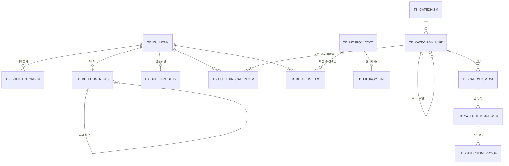

# 05. 교회 - 주보 · 교리문답 · 전례문

| 항목 | 내용 |
|---|---|
| 상태 | 구현 완료 · 테스트 통과 (기본 178/178, Oracle 3/3, 화면 단위 46/46, 화면 E2E 70/70) |
| 작성일 | 2026-11-08 |
| 원본 | 교회 주보 PDF (2026-11-08, 통권 9권 45호) 분석 |
| DDL (Oracle) | [`db/ddl/05_church.sql`](../../src/main/resources/db/ddl/05_church.sql) - 테이블 13개 |
| 초기 데이터 (local) | [`db/data/04_church.sql`](../../src/main/resources/db/data/04_church.sql) - 공통코드 5그룹, 하이델베르크 3부 + 제45주일(116~119문), 사도신경·주기도문, **가명** 샘플 주보 |
| 실제 주보 | `data/calendar-import.sql` 과 같은 방식으로 `data/church-import.sql` (개인정보·계좌 - 저장소에 올리지 않음, `/data/` gitignore). local 기동 시 optional 로 읽어 샘플 주보·교회 정보를 바꾼다 |
| 패키지 | 백엔드 `bulletin`, `catechism`, `liturgy` / 화면 `src/bulletin`, `src/catechism`, `src/liturgy` |

---

## 1. 주보 분석 → 설계

| 주보 영역 | 내용 | 설계 |
|---|---|---|
| 표지 | 날짜, 통권 n권 n호, 교회 이름, 섬기는 이, 표지 말씀·출처, 대표사진 | `TB_BULLETIN` (주보 1건 = 예배일 1일). 교회 이름·섬기는 이는 매주 같으므로 공통코드 `CHURCH_INFO` (언어별). 대표사진은 `PHOTO_KEY`·`PHOTO_TYPE` (아래 2-1) |
| 예배순서 | (항목, 담당·내용) × n | `TB_BULLETIN_ORDER` n행, 화면 [+ 순서 추가] |
| 말씀메모 | 자유 기록 | `TB_BULLETIN.SERMON_MEMO` (+ 설교 제목·본문·설교자 - 대시보드·목록용) |
| 교회소식 | 번호 섹션 → ♣ 항목(일정 포함) → 하위 줄 | `TB_BULLETIN_NEWS` 자기 참조 트리 (최대 3단계), 섹션·항목·하위 항목 모두 [+] |
| 섬김위원 | 역할 × 날짜(4주) 표 | `TB_BULLETIN_DUTY` (역할, 날짜, 담당자) 칸 단위. 화면은 표로 편집 [+ 역할] [+ 날짜] |
| 사도신경 · 주기도문 | 인도자/성도 교독, 매주 같은 본문 | **재사용 본문** `TB_LITURGY_TEXT` + `TB_LITURGY_LINE`(화자별 줄). 주보는 연결만 `TB_BULLETIN_TEXT` |
| 하이델베르크 요리문답 | 제45주일 116~119문, 문마다 인도자 질문 / 성도 답(첫째·둘째·셋째) | **재사용 본문** 교리문답 5단계 (아래). 주보는 단위만 연결 `TB_BULLETIN_CATECHISM` |

### 교리문답 (레이어가 많은 부분)

```
TB_CATECHISM               교리문답 (HEIDELBERG, 웨스트민스터 소요리 … 같은 구조로 추가)
 └ TB_CATECHISM_UNIT       단위 트리 - 자기 참조 (부 → 주일, 장 …), 유형은 공통코드 CATECHISM_UNIT_TYPE
     └ TB_CATECHISM_QA     문답 : 문 번호(교리문답 안에서 유일 UK) · 질문(인도자)
         └ TB_CATECHISM_ANSWER   답 단락 (첫째·둘째·셋째 …, 성도)
             └ TB_CATECHISM_PROOF 근거 성구 (구절·본문)
```

- 단위를 트리로 둔 이유 : 하이델베르크는 `부 → 주일`, 웨스트민스터는 `장`, 소요리는 단위 없이 문답만 - 교리문답마다 깊이가 달라도 테이블 변경 없이 수용
- 문답을 단위에 매달고 `CATECHISM_ID` 를 함께 저장 → 문 번호 유일성(UK)과 "주일 바꿔 달기"(단위 이동)를 동시에
- 답을 단락으로 나눈 이유 : 주보처럼 "첫째/둘째/셋째" 를 문단으로 보여주고, 근거 성구를 단락별로 달기 위해
- 언어 확장이 필요하면 `TB_CATECHISM_QA_LANG`, `TB_CATECHISM_ANSWER_LANG` 를 추가 (공지 `TB_NOTICE_I18N` 패턴)

### ERD



### 공통코드

| 그룹 | 코드 | 용도 |
|---|---|---|
| CHURCH_INFO | NAME, SERVED_BY | 표지·대시보드의 교회 이름, 섬기는 이 (코드명 = 표시 값, 언어별) |
| BULLETIN_STATUS | DRAFT 작성 중, PUBLISHED 게시 | 작성 중은 편집 권한자만 목록·상세에서 봄. 대시보드는 게시된 것만 |
| CATECHISM_UNIT_TYPE | PART 부, LORDS_DAY 주일, CHAPTER 장 | 단위 표시 `제45주일` |
| LITURGY_TYPE | CREED, PRAYER, RESPONSIVE, ETC | 전례문 분류 |
| LITURGY_SPEAKER | LEADER 인도자, PEOPLE 성도, ALL 다함께 | 줄 화자 (없으면 본문만) |

## 2. 저장 규칙

- 하위 행은 대리키(시퀀스) + 정렬순서. 부모 단위로 저장할 때 하위 전체를 **순서대로 교체**
  (JPQL bulk delete 로 즉시 삭제 → 재등록. 교회소식은 자기 참조 FK 때문에 상위 연결을 먼저 끊고 삭제,
  교리문답은 근거 성구 → 답 단락 → 문답 순서)
- 이번 주 주보 = 오늘 ~ 6일 뒤의 가장 이른 게시 주보, 없으면 오늘 이전 가장 최근 게시 주보 (`Clock`)
- 삭제 제약 : 하위 단위가 있는 단위(B9007), 주보에서 쓰는 단위(B9008)·전례문(B9503), 단위가 있는 교리문답(B9009)

### 2-1. 대표사진

- 주보당 1장. 파일은 공지 첨부와 같은 `FileStorage` (local 디렉터리 / db `TB_FILE_STORE`), 주보에는 저장 키(`PHOTO_KEY`)·형식(`PHOTO_TYPE`)만
- 형식은 파일명·Content-Type 이 아니라 **내용(시그니처)** 로 판별 - JPG, PNG, GIF, WEBP 만, 최대 10MB (B8009, B8010).
  응답 Content-Type 도 판별한 형식 + `nosniff` (HTML·SVG 위장 방지)
- 작성 중 주보의 사진은 주보와 같이 편집 권한자만 (B8001). 바꾸거나 지우거나 주보를 삭제하면 이전 파일은 커밋 후 저장소에서 삭제
- 화면 : 등록·수정 폼에서 고르면 미리보기(data URL - CSP 에 blob: 없음), 주보 저장 뒤 올린다 (새 주보는 ID 가 생긴 뒤).
  주보 보기 표지·대시보드 상단에 표시, 주소에 `?v={수정일시}` 로 캐시 갱신. 템플릿(새 주보)에는 사진을 복사하지 않는다
- 기존 Oracle DB : `ALTER TABLE TB_BULLETIN ADD (PHOTO_KEY VARCHAR2(64), PHOTO_TYPE VARCHAR2(50));`

## 3. API

| 리소스 | 경로 | 권한 |
|---|---|---|
| 주보 | `GET /api/v1/bulletins` (목록), `GET /current` (이번 주), `GET/PUT/DELETE /{id}`, `POST` | bulletin.* |
| 주보 PDF | `GET /{id}/pdf` (A4 가로 3단 2장, 첨부 `주보_{예배일}.pdf`) | bulletin.list |
| 주보 대표사진 | `GET /{id}/photo` (조회), `POST /{id}/photo` multipart `file` (등록 또는 수정), `DELETE /{id}/photo` (수정) | bulletin.list / add·edit / edit |
| 교리문답 | `GET /api/v1/catechisms` (단위 트리 + 단위별 문 범위), `POST/PUT/DELETE /{id}`, `GET/PUT/DELETE /units/{unitId}`, `POST /{id}/units` | catechism.* |
| 전례문 | `GET/POST /api/v1/liturgy-texts`, `GET/PUT/DELETE /{id}` | liturgy.* |

오류 : B8001~B8013 (주보, 사진 B8009~B8012, PDF B8013), B9001~B9009 (교리문답), B9501~B9503 (전례문)

## 4. 메뉴 · 권한

| 메뉴 (ID) | URL | PERM_CD | 화면 |
|---|---|---|---|
| 교회 (18) | `/church` | - | 상위 |
| 대시보드 (19) | `/church/dashboard` | bulletin | 대표사진·이번 주 예배·예배순서·이번 주 축하(생일 달력)·섬김위원·다가오는 일정·교회소식·교리문답 |
| 주보 (20) | `/church/bulletins` | bulletin | 목록 → 보기(인쇄 배치) → 등록·수정·다음 주 주보 만들기 |
| 교리문답 (21) | `/church/catechisms` | catechism | 왼쪽 목차 트리, 오른쪽 문답 보기 / 편집 (문답 → 답 단락 → 근거 성구 [+]). `?unit={단위ID}` 로 들어오면 그 단위를 연다 (대시보드 교리문답 링크) |
| 전례문 (22) | `/church/liturgy` | liturgy | 화자별 줄 편집 [+ 줄] |

권한 : 모듈마스터 전체, 모듈매니저 삭제 제외, 일반 사용자 조회 (DB) / Keycloak admin·tx.master 전체, tx.manager 조회·등록·수정, tx.viewer·emp01·partner01 조회

## 5. 화면 편의 기능

- **새 주보 = 가장 최근 주보 템플릿** : 등록 화면을 열면 가장 최근 주보(보기 화면의 "다음 주 주보 만들기" 는 그 주보)의 내용을
  **모두** 채운다 - 기본 정보·설교·말씀메모·예배순서·교회소식·섬김위원·교리문답·전례문. 바뀌는 값은 예배일 +7일(다가오는 주일보다
  이르면 다가오는 주일), 호 +1, 작성 중 뿐. "빈 양식으로" 로 비우고 새로 쓸 수 있다 (주보가 하나도 없으면 빈 양식)
- **교리문답 주차 자동** : 새 주보는 예배일이 그해 n번째 주일이면 제n주일 (2026-11-08 = 제45주일, 53번째 주일은 제52주일).
  템플릿에 있던 "주일" 단위를 같은 교리문답의 제n주일로 바꾸고, 없으면 하이델베르크 제n주일을 넣는다. 예배일을 바꾸면 다시 맞춤
  (직접 고친 교리문답은 그대로)
- **PDF 다운로드 (권장)** : `GET /api/v1/bulletins/{id}/pdf` - 원본 주보와 같은 **A4 가로 3단 접지 2장**
  (1장 교회소식·섬김위원 | 예배순서·말씀메모 | 표지, 2장 사도신경 | 주기도문 | 교리문답). 서버가 만들어(openhtmltopdf, 나눔고딕 OFL)
  아이패드·휴대폰 등 어느 기기에서도 같은 결과. 단마다 1쪽을 넘으면 글자 배율을 이분 탐색으로 줄인다 (최소 0.45).
  주보 보기·대시보드에 [PDF 다운로드]. 브라우저 인쇄는 Safari 가 @page·다단·zoom 을 따르지 않아 기기마다 다르다
- **인쇄 = A4 세로 딱 2장** : 1장 표지·예배순서·말씀메모·전례문, 2장 교회소식·섬김위원·교리문답 (장마다 2단).
  보기 화면이 body 에 인쇄용 사본을 두고 장마다 넘치면 글자 배율(zoom)을 줄여 맞춘다 (`beforeprint` 에 다시 계산).
  인쇄할 때는 앱 화면을 숨기고 `@page A4, 여백 0`. E2E 가 PDF 로 찍어 2장인지 확인
- **달력에서 축하 가져오기** : 그 주(일~토)의 생일·결혼기념일(생일 메뉴의 달력)을 교회소식 "축하" 섹션으로 (`이름(15 일)` 형식)
- 모든 반복 입력은 `RowTools`(위로·아래로·삭제) 로 순서 변경

## 6. 하이델베르크 요리문답 전체 이관 (`scripts/catechism-import/import_heidelberg.py`)

원본 : 북미개혁교회(CRC) 한글 번역 PDF (2012, 심재승 역 - crcna.org). PDF 표지에 "연구와 교육, 그리고 검토의 목적 외에 …
서면 허락없이 복사되지 말아야 한다" 는 저작권 고지가 있어 **본문은 저장소에 올리지 않는다**.
결과 `data/catechism-import.sql` (/data/ gitignore) 을 local 프로필이 optional 로 읽는다.

```bash
python -m venv .venv && .venv/Scripts/pip install pypdf
.venv/Scripts/python -I scripts/catechism-import/import_heidelberg.py <PDF> --dry-run --show 1 80 117
.venv/Scripts/python -I scripts/catechism-import/import_heidelberg.py <PDF>      # → data/catechism-import.sql, 앱 재시작
```

| PDF | 교리문답 5단계 |
|---|---|
| `제 n 부: 제목` | 부 1~3 (기존 단위 ID 1~3 의 제목 변경) |
| 구분선 뒤 소제목 (성부 하나님, 성례, 십계명, 주의 기도 …) | 그 다음 주일의 제목 |
| `제 n 주일` | 주일 (제1주일은 서론이라 최상위·맨 앞, 제45주일은 단위 ID 4 재사용 - 주보 연결 유지) |
| `제 n 문 : 질문` | 문답 (질문 속 각주 번호 제거) |
| `답 :` 빈 줄로 나뉜 문단 | 답 단락 (본문 속 각주 번호 제거, `제 1 계명` 같은 숫자는 유지) |
| `1) 성경 구절` | 근거 성구 - 번호가 나온 단락(질문에 있으면 첫 단락)에 |
| `*`, `**` 편집 주 (문 80) | `※` 로 시작하는 마지막 단락 |

2026-11-08 결과 : 부 3, 주일 52, 문답 129, 답 단락 223, 근거 성구 356.
